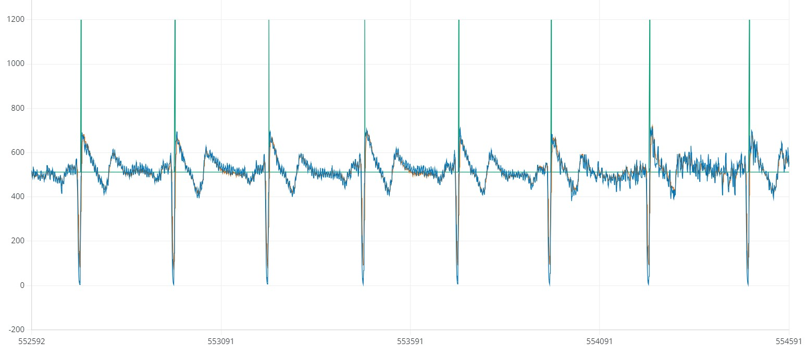

# Analiza kodu EKG — `ekg_test4_ino.ino`

Przeanalizowano **oryginalny, niezmieniony szkic użytkownika** dla Arduino Uno i OLIMEX SHIELD-EKG/EMG. Układ odczytuje sygnał analogowy z A0, filtruje go, wykonuje prostą detekcję progową i pokazuje trzy serie w Arduino Serial Plotter. To projekt edukacyjny; poprawna kompilacja i testy programu nie potwierdzają przydatności do pomiarów medycznych.

## Warunek zgodności sprzętu z oryginalnym kodem

**Kod nie wywołuje `analogReference(EXTERNAL)`, więc na Uno pozostaje domyślne odniesienie ADC z AVCC, nominalnie 5 V.** SHIELD-EKG/EMG ma własne odniesienie 3 V, które fabrycznie zamknięta zworka `REF_E` może łączyć z AREF Arduino. Ta konfiguracja odniesień jest niezgodna z oryginalnym szkicem i wymaga zmiany ustawień sprzętu przed uruchomieniem.

Dla opisanego tu, zachowanego bez zmian programu ustawienia są następujące: **`REF_E` otwarta, zworka zasilania 3.3/5V w pozycji 5V, `AIN_SEL` 1–2 dla A0, `CAL` otwarta**. AREF nie może być wtedy zasilane przez zewnętrzne odniesienie shielda. Szczegóły montażu i źródła producenta znajdują się w [README](README.md). To warunek konfiguracji sprzętu, którego kompilator ani test programu z atrapą nie weryfikują.

## Co robi program

| Etap | Rzeczywiste działanie |
| --- | --- |
| Wejście | `analogRead(ECG_PIN)`, gdzie `ECG_PIN = A0`. Wybór wyjścia A0 musi odpowiadać ustawieniu AIN_SEL shielda. |
| Harmonogram | `SAMPLE_PERIOD_US = 3906`; pętla sprawdza `micros()`. Zakładana częstotliwość do obliczenia filtrów: 256 Hz. |
| Filtr HP | `highPass = hpAlpha * (highPass + input - previousInput)`; tłumi składową stałą i wolne zmiany sygnału. |
| Filtr LP | `filtered += lpAlpha * (highPass - filtered)`; wygładza sygnał. |
| Detektor | Dodatni sygnał `filtered > 20`, z odstępem co najmniej 250 ms od poprzedniego zaakceptowanego zdarzenia. |
| BPM | `60000 / RR_ms` dla odstępów 250–2000 ms, po uzyskaniu poprzedniego zdarzenia. |
| Transmisja | 115200 baud, jeden wiersz co cztery odczyty: `rawADC`, `filtered + 512`, marker. Kolumny rozdziela tabulator. |
| Marker | 750 dla wykrycia w danej wysyłanej próbce, w pozostałych przypadkach 512. |

Po ustaleniu harmonogramu nominalnie powstają 256 odczyty i 64 wiersze wykresu na sekundę. **BPM pozostaje tylko w zmiennej `bpm` — obecny program go nie wyświetla ani nie przesyła.**

Dodane **512 to wyłącznie przesunięcie serii filtrowanej na ekranie**. Nie jest to kalibracja ani informacja o rzeczywistym poziomie środkowym sygnału z shielda. Przy nominalnym środku wyjścia toru analogowego około 1,5 V i odniesieniu ADC 5 V, surowy poziom środkowy wynosi około **307**, więc RAW i `FILTERED + 512` nie muszą się nakładać. Wartość wejścia 512 w testach poniżej jest celowo dobranym sygnałem syntetycznym, a nie pomiarem wartości spoczynkowej tego zestawu.

## Częstotliwość i filtry

Okres 3906 µs daje matematycznie **256,0164 Hz**, czyli minimalnie więcej od wpisanego `SAMPLE_RATE = 256.0`. To częstotliwość wynikająca z harmonogramu programu, a nie potwierdzony pomiarem rytm odczytów. `analogRead`, obliczenia, obsługa przerwań i ewentualne oczekiwanie na Serial wpływają na rzeczywiste odstępy. Program nie korzysta ze sprzętowego wyzwalania ADC.

Współczynniki wyliczone w `setup()` przy 256 Hz:

```text
hpAlpha = 0,9878769262
lpAlpha = 0,3802647728
```

Podane w kodzie 0,5 Hz i 25 Hz są parametrami wzorów RC. Dla zastosowanych równań dyskretnych:

- sam filtr HP ma punkt −3 dB względem swojego wzmocnienia przy najwyższych częstotliwościach około **0,497 Hz**;
- sam filtr LP ma punkt −3 dB względem wzmocnienia dla składowej stałej około **19,88 Hz**, a nie dokładnie 25 Hz.

Wartości wynikają z transmitancji `H_HP(z) = a(1 − z⁻¹)/(1 − az⁻¹)` i `H_LP(z) = b/(1 − (1 − b)z⁻¹)`. Są obliczeniami dla idealnego okresu 1/256 s, **nie charakterystyką zmierzonego toru analogowego ani pomiarem pasma całego zestawu**.

Wysłanie co czwartej próbki obniża nominalną częstotliwość danych na wykresie do 64 Hz, z częstotliwością Nyquista 32 Hz. Filtr LP pierwszego rzędu tłumi 32 Hz tylko o około **5,45 dB**. Samo pomijanie próbek nie zapewnia zatem skutecznego zabezpieczenia wykresu przed aliasingiem. Do dokładniejszej prezentacji po decymacji potrzebny byłby mocniejszy filtr przed zmniejszeniem częstotliwości albo przesyłanie wszystkich próbek. Dotyczy to danych wykresu; detektor w kodzie nadal działa przed dzielnikiem przez cztery.

## Ograniczenia potwierdzone w testach

1. **Nadrabianie czasu po starcie.** `lastSampleTime` zaczyna od zera, a `setup()` kończy się `delay(500)`. Kolejne wywołania `loop()` zwiększają termin tylko o 3906 µs, więc próbują odrobić około 128 zaległych okresów. To nowe odczyty wykonywane po starcie, a nie odzyskane próbki z wcześniejszych 500 ms. W atrapie z zatrzymanym zegarem wykonano dokładnie 128 odczytów; na rzeczywistym AVR liczba i odstępy zależą także od czasu wykonania programu. Taki sam mechanizm nadrabiania działa po dłuższym opóźnieniu pętli.

2. **Impuls od początkowego poziomu ADC.** `previousInput`, `highPass` i `filtered` startują od zera. Przy stałym wejściu 512 pierwsze przejście przez HP/LP daje dodatni impuls przekraczający próg i zostaje uznane za zdarzenie. Rozruch filtru może więc wytworzyć fałszywe wykrycie, zanim sygnał się ustali.

3. **Detekcja progu zamiast wyznaczenia maksimum R.** Warunek bada bieżący poziom `filtered > peakThreshold`. Nie szuka lokalnego maksimum ani przejścia sygnału z dołu na górę progu. Jeśli sygnał utrzyma się powyżej progu przez co najmniej 250 ms, może zostać policzony ponownie. Detektor reaguje bezpośrednio na dodatnie wychylenia; ujemny impuls sam w sobie nie spełnia warunku. Próg 20 jest wartością w jednostkach przetwarzanego ADC, bez przeliczenia na napięcie na skórze.

4. **Część markerów nie trafia na wykres.** `peakDetected` jest lokalne i zerowane w każdej próbce. Wysyłanie następuje tylko co czwarty odczyt. Zdarzenie wykryte w jednej z trzech pominiętych próbek nie zostaje zapamiętane do wysyłki, mimo że aktualizuje czas R–R. Przetestowano oba przypadki: utratę takiego markera i poprawne wysłanie 750, gdy wykrycie przypada dokładnie na czwarty odczyt.

5. **BPM może pozostać nieaktualne.** Po odstępie dłuższym od 2000 ms kod aktualizuje `lastRPeakTime`, lecz pozostawia poprzednią wartość `bpm`. Brak kolejnych wykryć też jej nie zeruje ani nie oznacza jako nieważną. Zakres 30–240 BPM wynika jedynie z przyjętych granic czasowych i nie określa dokładności ani wiarygodności pomiaru.

6. **Brak kalibracji i oceny jakości.** Nie ma kontroli kontaktu elektrod, automatycznego progu, oceny zakłóceń lub nasycenia ADC. Nie ma osobnego filtru zaporowego 50 Hz. Filtr dolnoprzepustowy może tłumić tę częstotliwość, lecz nie usuwa jej całkowicie. Nie zastosowano znanego, zwalidowanego detektora QRS.

## Co można powiedzieć o dołączonym JPG



Na zrzucie widać powtarzające się wychylenia sygnału oraz zielone znaczniki. Niebieski i pomarańczowy przebieg przebiegają w dużej części podobnie, przy czym widoczne są zakłócenia i zmienność amplitudy. To opis wyglądu wykresu, bez rozpoznawania stanu zdrowia ani potwierdzania, które wychylenia odpowiadają załamkom EKG.

**Zrzut nie odpowiada dokładnie wartościom wyjściowym obecnego szkicu:** zielone znaczniki osiągają około **1200**, a kod zawiera `Serial.println(750)`. Przy tym kodzie trzecia kolumna może mieć tylko 512 lub 750. JPG należy traktować jako dostarczony przykład z eksperymentu, możliwie z innej wersji programu; nie wiadomo, jakie pozostałe ustawienia obowiązywały podczas jego wykonania.

Oś pozioma nie ma podanej jednostki czasu i na samym JPG nie ma informacji o rzeczywistej częstotliwości transmisji. **Nie wyznaczamy z tego obrazu BPM, napięcia elektrod ani skuteczności detektora.** Poziom surowego sygnału około 500 też nie wystarcza do ustalenia zastosowanego odniesienia ADC lub konfiguracji zworki `REF_E`. Przebieg zbliżający się do dolnej granicy skali uzasadnia sprawdzenie surowych wartości i ewentualnego nasycenia toru, ale sam obraz go nie rozstrzyga.

## Weryfikacja techniczna

- Oryginalny `.ino` skompilowano i połączono dla **Arduino Uno, ATmega328P, 16 MHz**: Arduino AVR Boards 1.8.8, avr-gcc 7.3.0. Szkic przechodzi `-Wall -Wextra -Werror` bez ostrzeżeń. Wynik: **3840 B Flash i 230 B statycznego RAM**; stos i dynamiczne zużycie RAM nie są zawarte w tej drugiej liczbie.
- Wykonano **12 opisanych sprawdzeń** na rzeczywistych funkcjach `setup()` i `loop()`, kompilowanych natywnie z atrapami ADC, czasu i Serial. Sprawdzenia obejmują również wykazane ograniczenia — ich wynik `PASS` oznacza potwierdzenie analizy, nie bezbłędność algorytmu EKG.
- **Nie wykonywano pomiaru na fizycznym Arduino/shieldzie, testu bezpieczeństwa elektrycznego ani walidacji klinicznej.** Testy natywne nie symulują czasu wykonywania operacji na AVR, transmisji USB ani analogowej części SHIELD-EKG/EMG.

SHA-256 analizowanego, niezmienionego szkicu: `cfec25f11ab275e868900a282ee69b4c06084e4cb9802490c9e1a1ba0139e336`.

## Możliwe usprawnienia kolejnej wersji

Rozsądna kolejność dalszych prac to: uruchomienie harmonogramu po opóźnieniu startowym, inicjalizacja filtru od pierwszego odczytu, blokada detekcji na czas ustalania, zatrzaskiwanie markerów do wysyłki, detekcja maksimum z histerezą, jawne oznaczenie nieważnego/starego BPM, a następnie poprawa filtracji przed decymacją. Zmiana algorytmu wymagałaby osobnych testów z referencyjnymi danymi i pomiarem czasu działania. W obecnym zadaniu pozostawiono kod użytkownika bez zmian.
