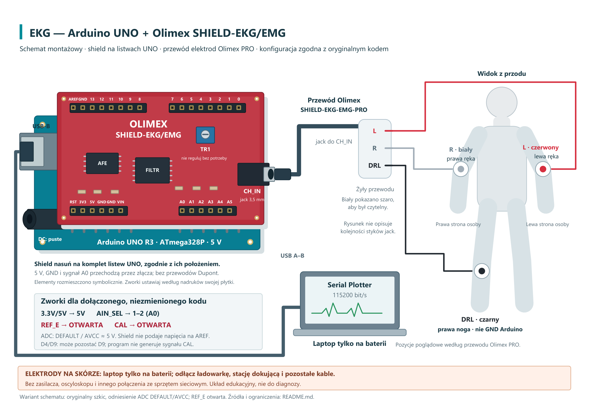
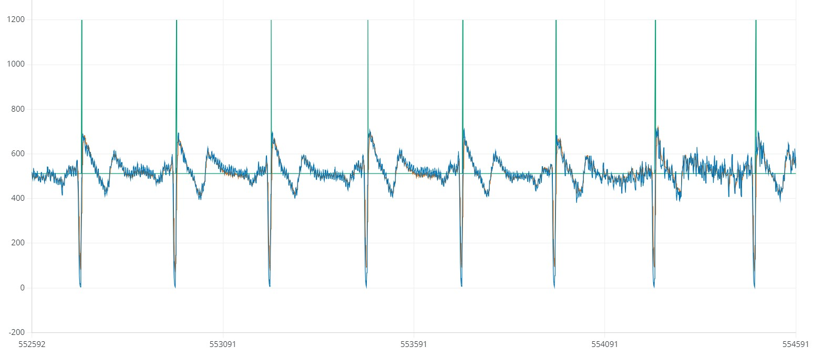

# EKG — Arduino UNO i Olimex SHIELD-EKG/EMG

Edukacyjna rejestracja sygnału z elektrod: Arduino odczytuje wyjście nakładki Olimex, filtruje próbki i rysuje przebiegi w Arduino Serial Plotter. Program pokazuje działanie prostego detektora progowego. **Nie jest urządzeniem medycznym ani narzędziem do diagnozy.**

Zachowano oryginalny [kod Arduino](ekg_test4_ino/ekg_test4_ino.ino) oraz dostarczony [wynik JPG](przyklady/ekg_wynik.jpg). [Analiza kodu](ANALIZA_KODU.md) opisuje jego rzeczywiste działanie, ograniczenia i wyniki testów.

## Potrzebne elementy

| Element | Ilość | Zastosowanie |
| --- | ---: | --- |
| Arduino UNO R3 / ATmega328P, **5 V** | 1 szt. | Odczytuje A0, przetwarza próbki i przesyła dane do komputera. |
| **Olimex SHIELD-EKG-EMG** | 1 szt. | Dodatkowa płytka: wzmacniacz i filtry sygnału z elektrod; nakładana na listwy UNO. |
| **Olimex SHIELD-EKG-EMG-PRO** | 1 szt. | Przewód elektrod z jackiem 3,5 mm i trzema zatrzaskami: L, R, DRL. |
| Kompatybilne elektrody żelowe, np. **ECG-GEL-ELECTRODE** | 3 szt. | Oddzielne elektrody do podłączenia przewodu PRO. |
| Przewód USB A–B z transmisją danych | 1 szt. | Łączy UNO z laptopem i zasila zestaw. |
| Laptop z Arduino IDE, pracujący na baterii | 1 szt. | Wyświetla przebiegi w Serial Plotter. |

**Przewód PRO nie zawiera elektrod żelowych** — są osobną pozycją zakupową. Przedstawione na schemacie kolory odnoszą się do tego przewodu; przy innym zestawie sprawdź dokumentację. Pełna lista z odnośnikami producenta i opisem dodatkowej płytki: [LISTA_ELEMENTOW.md](LISTA_ELEMENTOW.md).

**Przy elektrodach na skórze laptop ma pracować wyłącznie na baterii:** odłącz ładowarkę, stację dokującą i pozostałe kable. Nie podłączaj zasilacza, oscyloskopu ani innych urządzeń połączonych z siecią elektryczną. To warunek użycia tego projektu, a nie potwierdzenie zgodności układu z normami dla aparatury medycznej.

## Schemat i ustawienia

[Montaż — PDF](schematy/schemat_montazowy.pdf) · [Schemat elektryczny — PNG](schematy/schemat_elektryczny.png) · [Schemat elektryczny — PDF](schematy/schemat_elektryczny.pdf)

Przy odłączonym USB ustaw zworki zgodnie z nadrukami płytki i instrukcją producenta:

| Ustawienie | Dla dołączonego, niezmienionego kodu |
| --- | --- |
| `3.3V/5V` | **5V** |
| `AIN_SEL` | **1–2**, wyjście na **A0** |
| `REF_E` | **OTWARTA** — bez zewnętrznego napięcia na AREF Arduino |
| `CAL` | **OTWARTA** |
| `D4/D9` | Może pozostać D9; program nie używa generatora kalibracji |

**Sprawdź szczególnie `REF_E`.** Fabrycznie może być zamknięta i podawać około 3 V na AREF. Obecny szkic nie ustawia `analogReference(EXTERNAL)`; korzysta z domyślnego odniesienia ADC UNO, nominalnie 5 V. Nie wolno łączyć aktywnego zewnętrznego odniesienia z takim ustawieniem. Schemat pokazuje wariant z otwartą `REF_E`, bez zmiany programu.

Shield nasuń na komplet listew UNO. Zasilanie 5 V, GND i sygnał A0 przechodzą przez złącza — nie dodawaj osobnych przewodów między tymi punktami. Kabel elektrod podłącz do `CH_IN`: **L/czerwony — lewa ręka, R/biały — prawa ręka, DRL/czarny — prawa noga**. DRL jest wyjściem sprzężenia zwrotnego toru analogowego; **nie łącz go bezpośrednio z GND**. Na rysunku białą żyłę pokazano szaro dla czytelności; rozmieszczenie elementów na płytce jest poglądowe.

## Uruchomienie

1. W Arduino IDE wybierz **Arduino AVR Boards → Arduino Uno** i właściwy port.
2. Otwórz szkic `ekg_test4_ino/ekg_test4_ino.ino` i wgraj go. Nie wymaga dodatkowych bibliotek.
3. Otwórz **Serial Plotter / Kreślarkę portu szeregowego**, ustaw **115200 baud**.
4. Program przesyła trzy kolumny: surowy odczyt ADC, sygnał filtrowany przesunięty o 512 i marker detekcji (512 lub 750). Kolory zależą od programu wyświetlającego.

Odczyt jest zaplanowany nominalnie na 256 Hz, a na wykres trafia co czwarta próbka, czyli około 64 wiersze/s. Dodane 512 służy wyłącznie wyświetlaniu. Przy odniesieniu 5 V i środku wyjścia shielda około 1,5 V surowy poziom środkowy to około 307 jednostek ADC. Wartość BPM jest liczona w kodzie, ale **nie jest wysyłana na wykres**.

## Dostarczony przykładowy wynik

Obraz przedstawia powtarzające się wychylenia i zielone znaczniki. **Znaczniki na JPG sięgają około 1200, podczas gdy obecny szkic wysyła 750** — nie można przypisać tego zrzutu dokładnie tej wersji kodu. Bez danych źródłowych i jednostki osi czasu nie wyznaczamy z obrazu BPM ani napięcia na elektrodach.

[Wszystkie projekty](../../README.md)
