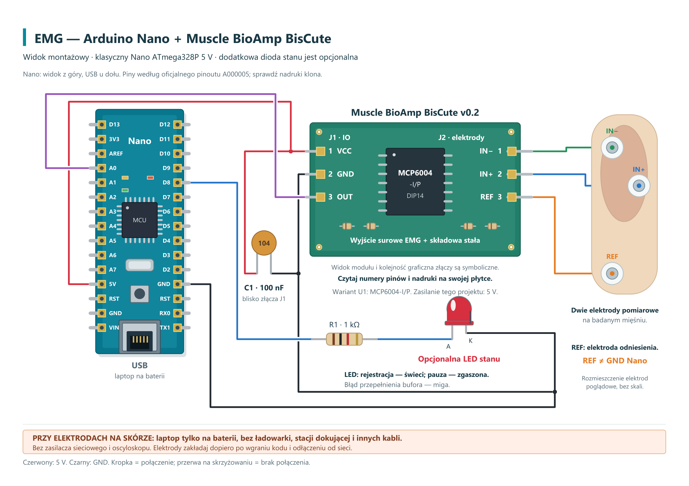

# EMG — rejestracja sygnału mięśniowego

Projekt dotyczy rejestracji powierzchniowego sygnału mięśniowego **sEMG** z użyciem **Arduino Nano ATmega328P, 5 V** i modułu **Muscle BioAmp BisCute z MCP6004**.

## Jak działa

Arduino pobiera surowy sygnał z wejścia **A0** z nominalną częstotliwością **4000 Hz**. Dane przesyła przez port szeregowy **115200 baud** w ramkach binarnych z indeksem próbek i kontrolą CRC. Polecenie `R` rozpoczyna pomiar, a `S` go zatrzymuje.

- [Kod Arduino](emg_nano/emg_nano.ino) i [nagłówek protokołu](emg_nano/EmgProtocol.h).
- [Opis transmisji i formatu danych](PROTOKOL.md).
- [Schemat montażowy](schematy/schemat_montazowy.png) i [schemat elektryczny](schematy/schemat_elektryczny.png).
- [Przykładowa analiza danych syntetycznych](przyklady/przyklad_syntetyczny.png) — ilustracja testu oprogramowania, nie pomiar EMG uczestnika.

Otwórz folder `emg_nano` w Arduino IDE i wybierz klasyczne Nano z ATmega328P, 16 MHz. Szkic oczekuje na polecenie startu. Do odbierania danych potrzebny jest program zgodny z opisanym protokołem; skrypt PC wspomniany w komentarzu szkicu nie jest częścią tego repozytorium. Transmisja binarna nie jest przeznaczona do Arduino Serial Plotter. FFT i analizę MDF wykonuje się na komputerze.

**Przy elektrodach na skórze laptop musi pracować wyłącznie z baterii, bez ładowarki, stacji dokującej i połączeń z innym sprzętem sieciowym. REF modułu nie jest GND Nano.** Projekt ma charakter edukacyjny; nie stanowi zwalidowanego urządzenia diagnostycznego.

Tor analogowy opiera się na otwartym projekcie [Muscle BioAmp BisCute — Upside Down Labs](https://github.com/upsidedownlabs/Muscle-BioAmp-BisCute). Dobór MCP6004 do zasilania 5 V wymaga sprawdzenia parametrów zmontowanego egzemplarza.

[← Wszystkie projekty](../../README.md)
