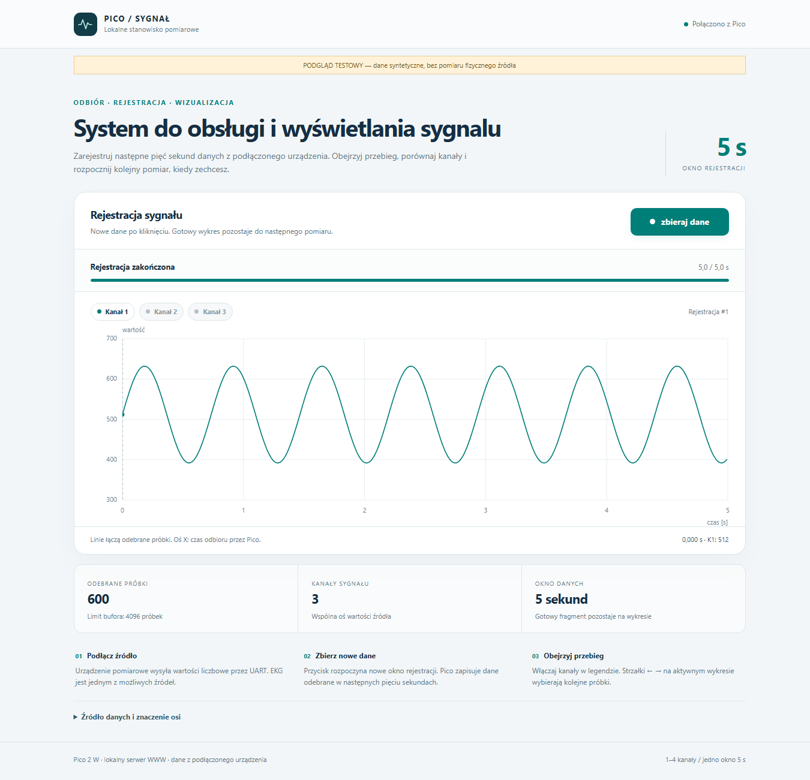
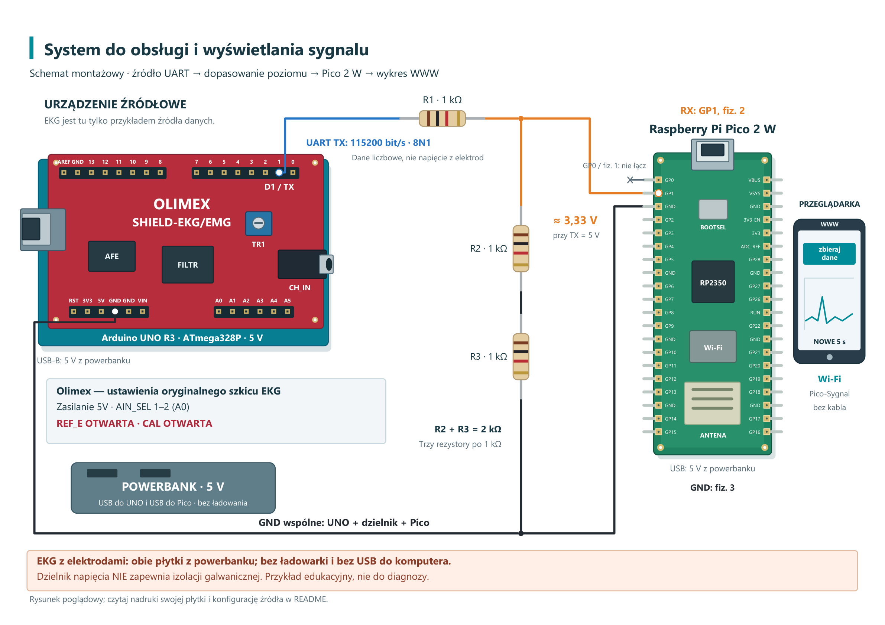

# System do obsługi i wyświetlania sygnalu

Uniwersalny rejestrator danych liczbowych z **UART**: Raspberry Pi **Pico 2 W** odbiera sygnał z urządzenia, udostępnia własną sieć Wi‑Fi i stronę z wykresem. Przycisk **„zbieraj dane”**, umieszczony nad wykresem, uruchamia zapis **następnych 5 sekund**. Po zakończeniu strona pokazuje zarejestrowany fragment. Kolejne kliknięcie rozpoczyna nową rejestrację.

**EKG jest przykładem źródła, a nie wymaganiem systemu.** Można podłączyć inny mikrokontroler, czujnik z wyjściem UART albo urządzenie pomiarowe, jeśli udostępni dane w opisanym formacie i z odpowiednimi poziomami elektrycznymi. Dla urządzeń analogowych, USB, RS‑232 lub RS‑485 potrzebna jest właściwa konwersja/interfejs — to nie jest wejście przyjmujące dowolne napięcie.

## Materiały

- [Program Pico 2 W](pico_serwer/pico_serwer.ino) — otwieraj w Arduino IDE z pozostałymi plikami tego folderu.
- [Jak przygotować dowolne urządzenie nadawcze](URZADZENIE_NADAWCZE.md).
- [Format danych i działanie rejestracji](PROTOKOL.md).
- [Nadajnik testowy — dwa sygnały syntetyczne](przyklady/nadajnik_testowy/nadajnik_testowy.ino).
- [Nadajnik analogowy — przykład odczytu A0 na UNO/Nano](przyklady/nadajnik_analogowy/nadajnik_analogowy.ino).

## Podgląd strony

Poniższy obraz pochodzi z testu interfejsu w przeglądarce. Pokazuje **dane syntetyczne, bez pomiaru fizycznego urządzenia**; nie jest zapisem EKG. Rzeczywista strona rysuje dane odebrane przez Pico i pozostaje pusta do zakończenia rejestracji.

## Jak działa rejestracja

1. Źródło **stale wysyła** wiersze liczb przez UART. Pico odbiera je niezależnie od obsługi strony.
2. Po przyjęciu polecenia z przycisku Pico usuwa zaległe dane wejściowe i rozpoczyna pięciosekundowe okno. Pierwszy koniec wiersza służy do synchronizacji. Nie pokazuje fragmentu zgromadzonego przed kliknięciem.
3. W tym oknie **5000 ms** zapisuje nowe, kompletne wiersze. Pasek postępu pokazuje stan rejestracji; w tym czasie nie można uruchomić drugiej.
4. Po zakończeniu przeglądarka pobiera dane i rysuje od 1 do 4 kanałów. Można włączać i wyłączać ich widoczność w legendzie.

Oś X oznacza **czas odbioru przez Pico**, w sekundach od początku okna. Oś Y przedstawia liczby wysłane przez źródło, bez automatycznego przeliczania na wolty, temperaturę czy jednostki EKG. Transmisja i buforowanie mogą wprowadzać opóźnienia względem chwili pomiaru w źródle.

Pierwszy wiersz po rozpoczęciu służy do synchronizacji i jest pomijany; może to pominąć jedną pełną próbkę. Źródło powinno więc wysyłać strumień ciągły, a nie jednorazowy wiersz. Wynik jest przechowywany w RAM do rozpoczęcia kolejnej rejestracji lub restartu Pico. Wszyscy klienci strony korzystają z tego samego rejestratora.

## Potrzebne elementy

| Element | Ilość | Zastosowanie |
|---|---:|---|
| Raspberry Pi **Pico 2 W**, ze złączami do przewodów | 1 | Odbiór UART, zapis i serwer Wi‑Fi. Zwykły Pico 2 nie ma Wi‑Fi. |
| Urządzenie wysyłające dane przez UART | 1 | Na początek może to być UNO/Nano z dołączonym nadajnikiem testowym. |
| Rezystory **1 kΩ** | 3 | Dzielnik dla pokazanego źródła z logiką 5 V. |
| Płytka stykowa i przewody | 1 komplet | Połączenie sygnału i wspólnej masy. |
| Zasilanie i odpowiednie kable USB | 1 komplet | Dla EKG z elektrodami: obie płytki z nieładowanego powerbanku. |
| Telefon lub komputer z Wi‑Fi i przeglądarką | 1 | Dostęp do strony; router i internet nie są potrzebne. |

Przy wyborze EKG potrzebne jest kompletne źródło opisane w projekcie [EKG z Olimex](https://github.com/frogmaker/Projekty_Arduino/tree/main/projekty/ekg): UNO, SHIELD-EKG-EMG i zestaw przewodu/elektrod. Sam Pico nie zastępuje analogowego toru pomiarowego.

## Schemat z przykładowym urządzeniem EKG

[Schemat montażowy](schematy/schemat_montazowy.png) · [Schemat elektryczny](schematy/schemat_elektryczny.png)

| Połączenie | Wariant UNO / Nano 5 V |
|---|---|
| Wyjście danych źródła | **D1 / TX** → R1 = 1 kΩ → węzeł wejściowy Pico |
| Wejście Pico | Ten węzeł → **GP1 / UART0 RX, fizyczny pin 2** |
| Dolna część dzielnika | Ten węzeł → R2 = 1 kΩ → R3 = 1 kΩ → GND |
| Masa | GND źródła, dzielnika i **GND Pico, fizyczny pin 3**, połączone razem |
| Pico GP0 / TX, fizyczny pin 1 | Pozostaw niepodłączony; transmisja jest jednokierunkowa |

Trzy rezystory tworzą dzielnik **5 V × 2/3 ≈ 3,33 V**. Dla poprawnego źródła UART z logiką **3,3 V** pomija się ten dzielnik i łączy TX z GP1 oraz GND z GND. Nie łącz obu wyjść TX. Dzielnik dopasowuje poziom sygnału, **nie zapewnia izolacji galwanicznej**. Numery GP i numery fizycznych pinów to różne oznaczenia.

**EKG z elektrodami:** zasil obie płytki z powerbanku, który podczas pomiaru nie jest ładowany. Odłącz USB do komputera, ładowarki, oscyloskop i inne połączenia ze sprzętem sieciowym. Programowanie i przepinanie wykonuj z odłączonymi elektrodami. To edukacyjny układ bez walidacji medycznej i potwierdzenia bezpieczeństwa aparatury medycznej.

Dla oryginalnego szkicu EKG ustaw nakładkę Olimex: **5V**, **AIN_SEL 1–2 / A0**, **REF_E otwarta**, **CAL otwarta**. Szczegóły i uzasadnienie znajdują się w [instrukcji EKG](https://github.com/frogmaker/Projekty_Arduino/blob/main/projekty/ekg/README.md).

## Uruchomienie w Arduino IDE

1. Wgraj do źródła program wysyłający dane. Pierwszy test wykonaj [nadajnikiem testowym](przyklady/nadajnik_testowy/nadajnik_testowy.ino), bez EKG i bez elektrod.
2. W Arduino IDE zainstaluj pakiet **Raspberry Pi Pico/RP2040/RP2350 by Earle F. Philhower**. Adres do Menedżera płytek: [oficjalny indeks Arduino-Pico](https://github.com/earlephilhower/arduino-pico/releases/download/global/package_rp2040_index.json). Projekt przygotowano dla **Arduino-Pico 6.3.2**.
3. Otwórz `pico_serwer/pico_serwer.ino` i pozostaw wszystkie pliki `.h` w tym samym folderze. Wybierz **Raspberry Pi Pico 2W**, architekturę ARM i standardowe 150 MHz. Biblioteki WiFi i WebServer są częścią tego pakietu.
4. Sprawdź ustawienia w [config.h](pico_serwer/config.h): UART **115200 baud, 8N1**, RX **GP1**, sieć **Pico-Sygnal**, hasło **12341234**. Hasło jest przykładowe; zmień je przed udostępnieniem układu, zachowując co najmniej 8 znaków.
5. Wgraj program do Pico i wykonaj połączenia zgodnie ze schematem. Uruchom źródło ciągłych danych.
6. Połącz telefon lub komputer z siecią **Pico-Sygnal**. Potwierdź pozostanie w sieci bez internetu i otwórz **http://192.168.4.1/**.
7. Naciśnij **„zbieraj dane”**, odczekaj 5 sekund i obejrzyj wykres. Następny zapis rozpoczynasz tym samym przyciskiem.

Strona, wykres i skrypty są zapisane w programie Pico; nie korzystają z CDN ani zewnętrznych usług. Monitor USB Pico, jeśli używany podczas testu bez elektrod, działa przy 115200 i pokazuje informacje startowe. Do samej rejestracji komputer ani otwarty monitor nie są potrzebne.

## EKG jako przykład

Dotychczasowy szkic EKG wysyła trzy kolumny liczb rozdzielonych tabulatorami i kończy wiersz przez `Serial.println()`. Odbiornik przyjmuje ten format bez modyfikowania źródła:

| Kanał na stronie | Dane z oryginalnego EKG |
|---|---|
| 1 | Surowy odczyt ADC |
| 2 | Wynik filtracji przesunięty o 512, tak jak w dotychczasowym wykresie |
| 3 | Marker detekcji: 512 lub 750 |

Oryginalny szkic przetwarza sygnał nominalnie przy 256 Hz, ale wysyła co czwartą próbkę, około **64 wierszy/s**. Pięciosekundowy zapis da zatem około **320 wierszy**, a nie 1280. Pico nie odzyskuje pominiętych próbek i nie oblicza BPM; pokazuje to, co przesłało urządzenie. Ograniczenia detektora opisano w [analizie oryginalnego kodu EKG](https://github.com/frogmaker/Projekty_Arduino/blob/main/projekty/ekg/ANALIZA_KODU.md).

## Zakres i ograniczenia

- Format wejścia: **1–4 kanały**, liczby ze znakiem i kropką dziesiętną, jeden zestaw w każdym wierszu. Pełny opis: [PROTOKOL.md](PROTOKOL.md).
- Limit rejestracji: **4096 wierszy w 5 sekund**. To limit bufora, nie gwarancja częstotliwości transmisji; znaczenie mają także długość wierszy, baud rate i urządzenie nadawcze.
- Przekroczenie bufora lub przepełnienie UART jest pokazywane jako problem z kompletnością. Błędne wiersze i zmiana liczby kanałów są odrzucane. Nie traktuj takiego zapisu jako kompletnego pomiaru.
- Brak źródła kończy pięciosekundową rejestrację pustym wynikiem i informacją o braku danych.
- Źródło nie jest sterowane przez przycisk: nadal nadaje, a Pico wyznacza, które odebrane wiersze zapisać. Dane poza oknem są pomijane.
- Wyniki są lokalne i nietrwałe. Osoby połączone z tą samą siecią mogą oglądać ostatni zapis i uruchamiać kolejne rejestracje.

## Gdy coś nie działa

| Objaw | Co sprawdzić |
|---|---|
| Brak sieci | Wybór Pico **2 W**, zasilanie i hasło długości co najmniej 8 znaków. |
| Strona się nie otwiera | Połączenie z Pico-Sygnal, adres **http://192.168.4.1/** i pozostanie w sieci bez internetu. |
| Po 5 s brak danych | Czy źródło stale nadaje z właściwego **sprzętowego TX**, ma 115200/8N1 i kończy wiersze znakiem LF; sprawdź GP1 i wspólną masę. |
| Błędne wiersze | Usuń komunikaty opisowe, jednostki i etykiety, użyj kropki dziesiętnej i stałej liczby kolumn; sprawdź poziomy napięć i baud rate. |
| Niepełny zapis | Zmniejsz częstotliwość/długość wierszy albo dopasuj bufor; przejrzyj liczniki pokazane na stronie. |
| Rejestracja zajęta / zmieniony wynik | Inny klient korzysta z tego samego rejestratora; odczekaj do zakończenia i rozpocznij nowy zapis. |

## Źródła i weryfikacja

Podstawą połączeń są [dokumentacja Pico 2 W](https://www.raspberrypi.com/documentation/microcontrollers/pico-series.html), [pinout UNO](https://docs.arduino.cc/resources/pinouts/A000066-full-pinout.pdf), [instrukcja Olimex](https://www.olimex.com/Products/Duino/Shields/SHIELD-EKG-EMG/resources/SHIELD-EKG-EMG.pdf) i [opis UART w Arduino-Pico](https://arduino-pico.readthedocs.io/en/latest/serial.html). RP2350 ma warunkowo tolerujące 5 V wejścia cyfrowe, gdy jest odpowiednio zasilany — [wyjaśnienie producenta](https://www.raspberrypi.com/news/rp2350-a4-rp2354-and-a-new-hacking-challenge/). Pokazany dzielnik pozostaje wybranym wariantem dopasowania poziomów dla źródła 5 V.

Program Pico przeszedł pełną kompilację dla **Pico 2 W / Arduino-Pico 6.3.2**. Oba nadajniki skompilowano dla **UNO/Nano, ATmega328P 16 MHz / Arduino AVR Boards 1.8.8**. Jedenaście testów parsera i pięciosekundowego okna sprawdziło m.in. błędne dane, przepełnienie bufora, granice czasu i zawinięcie licznika. Dziesięć grup testów strony w przeglądarce sprawdziło przycisk, pobieranie wyniku, widok telefonu, błędne dane i obsługę przerw w połączeniu — z syntetycznymi odpowiedziami API, bez fizycznego Pico. Schematy porównano z wymaganymi połączeniami. Testy programowe nie zastępują sprawdzenia fizycznego UART, zasilania i układu z elektrodami.

[← Wszystkie projekty](https://github.com/frogmaker/Projekty_Arduino)
